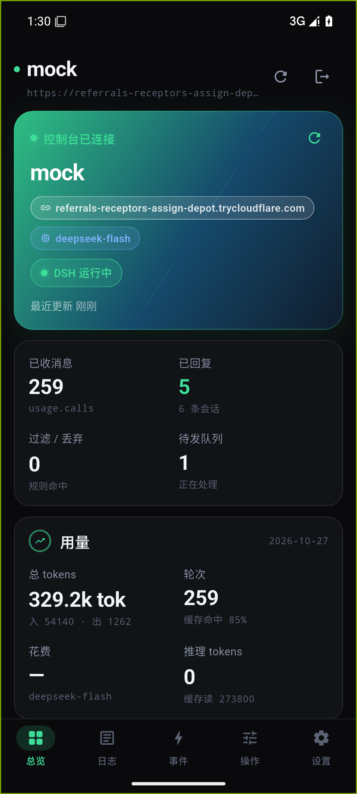

# QQA 助手 · Rust + Flutter 重写版

基于 `QQA-Assistant-Public-1.0.4` 的**逻辑**重写的 Android 客户端。
界面按深色 OLED + 绿色强调的视觉稿重做，底层换成 Rust 核心 + Flutter UI。

- 包名：`cn.local.qqa.qqa_assistant`（与原版一致，可覆盖安装需先卸载，签名不同）
- 版本：1.1.0
- 产物：`flutter build apk --release --target-platform android-arm64`（约 20 MB，arm64-v8a）



## 下载

从 [Releases](https://github.com/Lumidouces/qqa-assistant/releases) 取最新 APK：

| 文件 | 架构 | 说明 |
|---|---|---|
| `QQA-Assistant-1.1.0-arm64.apk` | arm64-v8a | 绝大多数真机（2017 年后的手机） |
| `SHA256SUMS.txt` | — | 校验用 |

```bash
adb install -r QQA-Assistant-1.1.0-arm64.apk
# 或直接把 APK 传到手机点安装（需允许「安装未知来源应用」）
```

**签名**：release 版用项目密钥签名（`CN=QQA Assistant`），SHA-256 指纹
`50F6EEB6BEB33AC97E86FEE3FB2746668498D8E895D87097C906EED76BAFE97B`。
装过 v1.0.0 的机器因签名不同需先卸载。

## 这是什么

一个看 QQA（QQ Agent）控制台的手机端。8 个 HTTP 端点、5 个页面，全部只读 + 一个暂停开关。
没有账号体系，没有云端，地址和 token 都只存在本机 `SharedPreferences` 里。

## 和原版的关系

**保留**（与原版逐字对齐，重写时照抄契约）：

- 8 个 `/api/` 端点：`status` / `sessions` / `chats` / `chats/{key}/messages` /
  `sessions/{id}` / `skills` / `pause`。
- 只允许 `/api/` 前缀、禁 `..`；10 MB 上限；10s 连接 / 15s 读超时。
- 错误文案逐条对齐（401/403、502/503、证书失败、连不上、超时）。
- 两个账号槽、地址规范化（必须 `https:`、不带 `/api` 与查询串）。
- 5 个页面：总览 / 日志（会话过程 + 消息存档）/ 事件 / 操作 / 设置。

**重写**：

| 层 | 原版 | 现在 |
|---|---|---|
| UI | Java 手写 View（714 行 MainActivity） | Flutter，深色 + 绿色，卡片圆角 16-20 |
| 核心 | 全在 Java 里 | Rust `qqa_core`（FFI：cdylib）做地址校验、CQ 码清洗、文本截断、时间格式化 |
| 请求 | `HttpsURLConnection` | `dart:io HttpClient` |
| 设置 | SharedPreferences 散落 key | `AppStore` 统一封装，schema 化 |

## 1.1.0 变更（对接真实控制台）

1.0.0 只跑过自写的 mock，字段名与真实 `/api/*` 有出入，1.1.0 按真实响应全部改掉：

| 位置 | 真实形状 | 处理 |
|---|---|---|
| 会话列表 | 无 `sentCount`；`usage.calls` 是**模型调用次数**（每条 ≥1） | 「已回复」改用 `status == 'done'` 计数，不再用 `sentCount > 0`（否则永远是 50/50） |
| 会话详情 | `sent[]` 恒为空，对话在 `messages[]` 里 | 有 `messages` 就渲染，`sent` 有内容才显示 |
| 消息条目 | 两种形状：`{role, content}` 与 `{toolCall:{name,args,result}}` | 两种都渲染；工具调用单独成卡，`isError` 标红 |
| 触发内容 | 列表用 `trigger` 字符串，详情用 `triggerSummary` / `triggerText` | 三选一兜底 |
| 群消息 | 无 `role`，但有 `senderName` + 毫秒 `at` | 气泡上方显示发言人，右下角显示 `HH:mm` |
| 状态 | `onebot.self.nickname`、`usage.runs`、`cost` | 状态卡多一枚昵称 chip；花费按真实 `cost` 显示 |

所有字段兼容逻辑集中在 `lib/core/models.dart` 一处（`fromJson` 里同时吃真实与 mock 两种形状），
其余 UI 层不写兜底。

## 构建

需要：Flutter 3.35.x、Android SDK 35 + NDK 27、Rust（x86_64-pc-windows-gnu host）。

```bash
# 国内拉 engine 必须设，否则只有 40KB/s
export FLUTTER_STORAGE_BASE_URL=https://storage.flutter-io.cn

# 1. Rust 核心 → .so
bash tools/build-rust.sh          # 产物进 android/app/src/main/jniLibs/{arm64-v8a,x86_64}

# 2. 打包
flutter build apk --release --target-platform android-arm64   # 真机
flutter build apk --debug   --target-platform android-x64     # 模拟器
```

`android/app/build.gradle.kts` 里的 `resolvedAbi` 会把 `-Ptarget-platform` 映射成
`abiFilters`，**不要**只传 `--target-platform` 就以为打进去了 —— Flutter 不设
`targetAbi`，不映射的话 APK 里会缺 `libflutter.so`，装上就闪退。

### 签名

`android/key.properties` 已被 git 忽略。复制示例文件填入自己的 keystore：

```bash
cp android/key.properties.example android/key.properties
# 没有 keystore 就先生成一个：
keytool -genkeypair -v -keystore android/app/my-release.jks \
        -alias qqa -keyalg RSA -keysize 2048 -validity 10000
```

文件缺失时 release 构建会回退到 debug 签名，本地自测仍可 `flutter build apk --release`。

## 本地跑（模拟器 + mock 服务）

```bash
node tools/mock-qqa.mjs                                        # 127.0.0.1:8788
cloudflared tunnel --url http://127.0.0.1:8788 --no-autoupdate # 拿 https 地址（App 只收 https）
adb install -r build/app/outputs/flutter-apk/app-debug.apk
adb shell am start -n cn.local.qqa.qqa_assistant/.MainActivity
```

App 只接受 `https:` 地址，所以本机 mock 必须经隧道或自签证书，不能直连 `http://127.0.0.1:8788`。

## 已验证

**1.1.0 对真实控制台**（自建服务器上跑着的 QQA，经 cloudflared 隧道），
Android 15 API 35 x86_64 模拟器实测：总览显示真实机器人昵称、模型名、调用次数、
已回复数、tokens、花费、缓存命中率；消息存档列出 13 个真实群 / 私聊会话（带最后一句预览与
消息数）；会话详情显示轮次/工具/模型/tokens 徽章、触发内容与模型过程（含工具调用报错原文）。

**1.0.0 对 mock**（`tools/mock-qqa.mjs`）：

| 页面 | 截图 |
|---|---|
| 总览 | `tools/d-overview.png` |
| 日志 | `tools/d-logs.png` |
| 会话详情 | `tools/d-detail.png` |
| 消息存档 | `tools/d-chat.png` |
| 事件 | `tools/d-events.png` |
| 操作 | `tools/d-tools.png` |
| 设置 | `tools/d-settings.png` |
| 暂停态 | `tools/d-paused.png` |

`pause` 真打接口验证：点「暂停」后 `GET /api/status` 返回 `paused: true`，恢复后 `false`。

## 实测踩到的坑

1. **模拟器 `-no-window` 必须加**。带窗口跑几次都被宿主杀掉（`qemu` 进程凭空消失），
   无窗口模式稳定。启动用 `powershell Start-Process` 或后台 job，别用 `nohup &`。
2. **Git-Bash 会篡改 adb 参数**。`adb pull /sdcard/x.png tools/x.png` 会把 `/sdcard` 当路径转换，
   报 `failed to stat remote object 'C:/.../sdcard/x.png'`。必须 `export MSYS2_ARG_CONV_EXCL='*'`。
3. **换签名要卸载**。debug 与 release 签名不同，`INSTALL_FAILED_UPDATE_INCOMPATIBLE` 时先
   `adb uninstall cn.local.qqa.qqa_assistant`。
4. **预置账号用 `run-as`**。模拟器上想跳过手输地址，直接把 `FlutterSharedPreferences.xml`
   push 进 `shared_prefs/`（`adb shell run-as cn.local.qqa.qqa_assistant cp ...`）。
5. **NDK clang 在 Windows 上是 `.cmd`**。NDK 目录里同时有 `aarch64-linux-android24-clang`
   （POSIX 脚本）和 `.cmd` 包装器，前者不是有效 Win32 可执行文件。`build-rust.sh` 在
   Windows 上优先找 `.cmd`/`.exe`，否则 cargo 报 `os error 193 / not a valid Win32 application`。
6. **JDK 25 打不了包**。Gradle 8.12 在 JDK 25 上直接 `BUILD FAILED`，错误信息只有一行
   `25.0.3`。用 JDK 21：`export JAVA_HOME="/c/Program Files/Java/jdk-21.0.10"`。

## 测试

```
flutter analyze        → No issues found
flutter test           → 7 passed
cd rust && cargo test  → 10 passed
```

## 许可

MIT，见 [LICENSE](LICENSE)。原版 `QQA-Assistant-Public-1.0.4` 的契约与行为归原作者。
